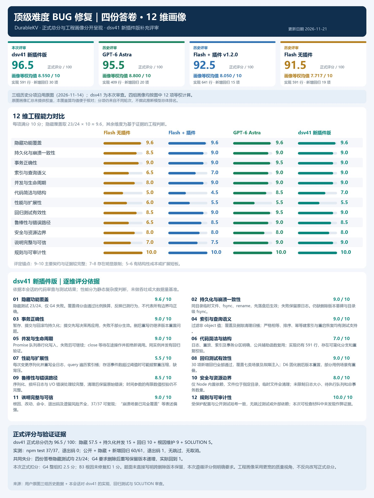

# Hardest Bug Fix: Three Historical Submissions and One Supplementary Review

**Historical review**: 2026-11-14 · **Supplementary review**: 2026-11-21 · **Historical reviewers**: Claude Opus 5.5 and Kimi K3.1 Pro (provided by the user) · [Index](README.en.md) · [中文](bugfix-2026-11-14.zh.md)

## The task

DurableKV: a persistent key-value store with an append log, atomic replace, version tombstones and crash recovery. Fix the defects surfaced by hidden tests and add regression tests.

- 7 public tests (not scored; used to detect deleted or weakened assertions)
- 24 hidden tests across 12 behaviour groups, 5 points each, 60 points total
- 40 manual points: implementation review 15 + regression quality 10 + root cause and maintainability 10 + SOLUTION and verification evidence 5

## Totals

| Submission | Code after fix | New regression tests | Executable | Equal-weight profile | Manual | Total |
|---|---:|---:|---:|---:|---:|---:|
| GPT-6 Astra | 409 lines | 20 | 57.5 / 60 | 8.800 / 10 | 38.0 / 40 | **95.5** |
| Flash + v4.1 Pro plugin v1.2.0 | 641 lines | 15 | 57.5 / 60 | 8.050 / 10 | 35.0 / 40 | **92.5** |
| Flash, no plugin | 591 lines | 19 | 57.5 / 60 | 7.717 / 10 | 34.0 / 40 | **91.5** |
| dsv41 new plugin build (2026-11-21 supplementary review) | 591 lines | 30 | 57.5 / 60 | 8.550 / 10 | 39.0 / 40 | **96.5** |

All three historical submissions stopped at 23/24 hidden tests, losing 2.5 points in group G4: deletion did not keep a version tombstone, so after delete, recreate and reopen, `version` fell back to 1. The fourth, dsv41, is likewise stuck on G4; in addition, the task statement never said a deleted version must be preserved, and the review applied the version-retention contract, so dsv41 lost another point for the unfixed B3, giving 39/40 manual.

The “equal-weight profile” in the figure is for horizontal comparison only, not the official total; the official total is still executable points + manual review.

## Twelve dimensions

Each dimension is scored out of 10. This is a profile, not a sum that produces the total. The three historical columns follow the user's original figure; the fourth comes from the 2026-11-21 supplementary review.

| Dimension | Flash no plugin | Flash + plugin | GPT-6 Astra | dsv41 new plugin |
|---|---:|---:|---:|---:|
| Hidden-function coverage | 9.6 | 9.6 | 9.6 | 9.6 |
| Durability and crash consistency | 8.5 | 9.0 | 9.0 | 9.0 |
| Transaction correctness | 9.0 | 9.0 | 9.5 | 9.0 |
| Index and query semantics | 6.5 | 7.0 | 9.0 | 9.0 |
| Concurrency and lifecycle | 8.0 | 9.0 | 9.0 | 9.0 |
| Code simplicity and structure | 5.0 | 4.5 | 8.5 | 7.0 |
| Performance and scalability | 6.0 | 5.5 | 5.5 | 5.5 |
| Regression effectiveness | 8.5 | 9.0 | 9.5 | 9.0 |
| Robustness and error paths | 6.5 | 8.5 | 9.0 | 8.5 |
| Security and resource bounds | 8.0 | 8.0 | 8.0 | 8.0 |
| Documentation and credibility | 7.0 | 7.5 | 9.0 | 9.0 |
| Rules and auditability | 10.0 | 10.0 | 10.0 | 10.0 |
| **Equal-weight mean** | **7.717** | **8.050** | **8.800** | **8.550** |

## Key differences

- **Shared loss**: all four passed only 23/24. G4's version tombstone was not preserved; the version number goes backwards after a reopen.
- **GPT-6 Astra**: atomic publication of candidate state, one state machine shared by recovery and runtime, 20 new regression tests. Weakness: rebuilds the index on every write, expensive over a long run.
- **Flash + plugin**: validation, cleanup and concurrency paths are comparatively complete; but the code is the longest (641 lines), non-object keys are not indexable, and the automatic compaction threshold has no effect.
- **Flash without plugin**: 19 new regression tests; it reads an incomplete trailing log fragment as a valid record and freezes that mistake into a test; non-object keys are likewise not indexable.
- **dsv41 new plugin**: strong transaction, index, concurrency and regression coverage; all 30 new regression tests pass. Still 591 lines with room to shrink, performance is weak, G4 is unfixed, and B3 is unfixed.

## Executable evidence

- Public tests 7/7 for the three historical submissions; hidden tests 23/24 for all; the non-zero grader exit code is the real G4 failure, not an execution fault.
- Public test files and `package.json` were not modified.
- The original implementation was 209 lines; the repaired versions are 591 / 641 / 409 / 591 lines; new regression tests are 19 / 15 / 20 / 30.
- dsv41 supplementary review: `npm test` 37/37, exit 0; public + hidden + new regression 60/61, exit 1, no skips, no cancellations — the failure comes from real G4 behaviour, not from the test framework.

## The figure

This is the 2026-11-21 update: the three historical scores keep the original figure's data, and the fourth, dsv41, is a supplementary review. The three historical totals were given by Claude Opus 5.5 and Kimi K3.1 Pro; the executable part came from the automated grader. The fourth was scored in this session from its implementation, regression tests and SOLUTION. The reviewers' judgement is a subjective review, not a statistical result from repeated runs.

## Boundaries

- One task; the three historical submissions were one review, and the fourth is a 2026-11-21 supplementary review, not the same round, not blind, not repeated.
- This does not rank models overall, and the plugin-minus-baseline gap cannot be attributed directly to the plugin.
- “GPT-6 Astra”, “Flash”, “dsv41” are submission directory labels; backend model, reasoning effort and budget were not independently verified.
- The 12-dimensional profile and its equal-weight mean are a review lens, not the official score; the fourth's B3 deduction depends on an interpretation of the version-retention contract that the task statement does not spell out verbatim.
