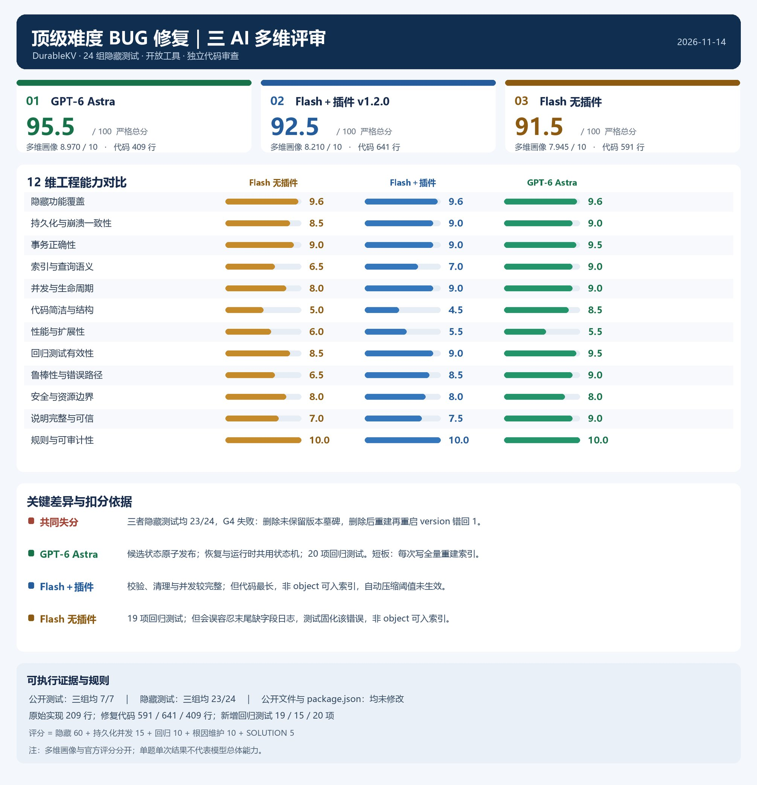

# 顶级难度 BUG 修复：三份提交的多维评审

**日期**：2026-11-14 · **评分者**：Claude Opus 5.5、Kimi K3.1 Pro（用户提供） · [总览](README.md) · [English](bugfix-2026-11-14.en.md)

## 题目

DurableKV：一个带追加日志、原子替换、版本墓碑与崩溃恢复的持久化键值存储。修复隐藏测试暴露的缺陷，并补充回归测试。

- 公开测试 7 项（不计分，只用于检查是否删改断言）
- 隐藏测试 24 项，按 12 个行为组计分，每组 5 分，共 60 分
- 人工评审 40 分：实现审查 15 + 回归质量 10 + 根因与可维护性 10 + SOLUTION 与验证证据 5

## 总分

| 提交 | 修复后代码 | 新增回归 | 可执行分 | 多维画像 | 人工评审 | 总分 |
|---|---:|---:|---:|---:|---:|---:|
| GPT-6 Astra | 409 行 | 20 项 | 57.5 / 60 | 8.970 / 10 | 38.0 / 40 | **95.5** |
| Flash＋v4.1 Pro 插件 v1.2.0 | 641 行 | 15 项 | 57.5 / 60 | 8.210 / 10 | 35.0 / 40 | **92.5** |
| Flash 无插件 | 591 行 | 19 项 | 57.5 / 60 | 7.945 / 10 | 34.0 / 40 | **91.5** |

可执行部分三份都停在 23/24 个隐藏测试、G4 组失 2.5 分：删除后没有保留版本墓碑，删除、重建并重开后 `version` 错回 1。其余 40 分由评分者按代码与证据人工给出，这是三份总分拉开差距的地方。

## 12 维评审

每维满分 10 分，是多维画像，不是直接加总成总分。

| 维度 | Flash 无插件 | Flash＋插件 | GPT-6 Astra |
|---|---:|---:|---:|
| 隐藏功能覆盖 | 9.6 | 9.6 | 9.6 |
| 持久化与崩溃一致性 | 8.5 | 9.0 | 9.0 |
| 事务正确性 | 9.0 | 9.0 | 9.5 |
| 索引与查询语义 | 6.5 | 7.0 | 9.0 |
| 并发与生命周期 | 8.0 | 9.0 | 9.0 |
| 代码简洁与结构 | 5.0 | 4.5 | 8.5 |
| 性能与扩展性 | 6.0 | 5.5 | 5.5 |
| 回归测试有效性 | 8.5 | 9.0 | 9.5 |
| 鲁棒性与错误路径 | 6.5 | 8.5 | 9.0 |
| 安全与资源边界 | 8.0 | 8.0 | 8.0 |
| 说明完整与可信 | 7.0 | 7.5 | 9.0 |
| 规则与可审计性 | 10.0 | 10.0 | 10.0 |

## 关键差异

- **共同失分**：三份都只过 23/24，G4 的版本墓碑没有被保留。删除后重开，版本号回退。
- **GPT-6 Astra**：候选状态原子发布，恢复与运行时共用状态机；新增 20 项回归。短板是每次写入都重建索引，长跑成本高。
- **Flash＋插件**：校验、清理与并发路径较完整；但代码最长（641 行），非对象键不可索引，自动压缩阈值未生效。
- **Flash 无插件**：新增 19 项回归；但会把日志末尾的不完整片段误读为合法记录，并用测试把这个错误固化；非对象键同样不可索引。

## 可执行证据

- 三份公开测试均 7/7；隐藏测试均 23/24；评分脚本退出码非零是因为 G4 真实失败，不是执行故障。
- 公开测试文件与 `package.json` 均未修改。
- 原始实现 209 行；三份修复后代码分别为 591 / 641 / 409 行；新增回归 19 / 15 / 20 项。

## 这张图

图中的多维评分与总分由 Claude Opus 5.5 与 Kimi K3.1 Pro 给出；可执行部分来自自动评分脚本。评分者的判断是主观评审，不是重复实验的统计结果。

## 边界

- 单题、单次、三份提交；不能据此给出模型总体排名，也不能把插件版与无插件版的 1 分差归因于插件。
- “GPT-6 Astra”“Flash”等是答卷目录标签，未独立核验后端模型、推理档位与预算。
- 多维评审由两位评分者完成，没有盲评与重复评分记录。
